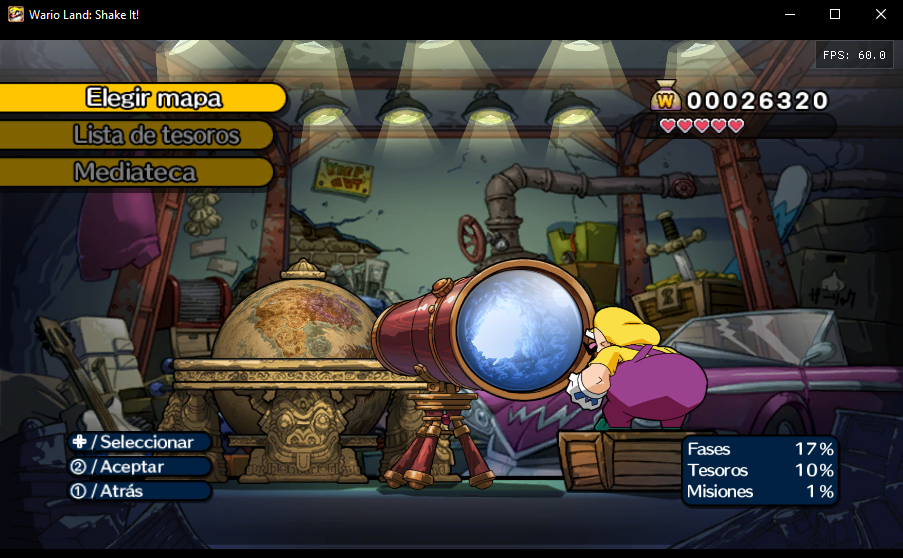
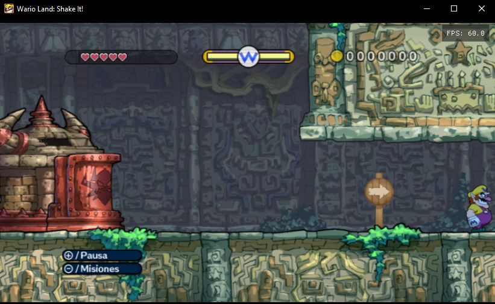
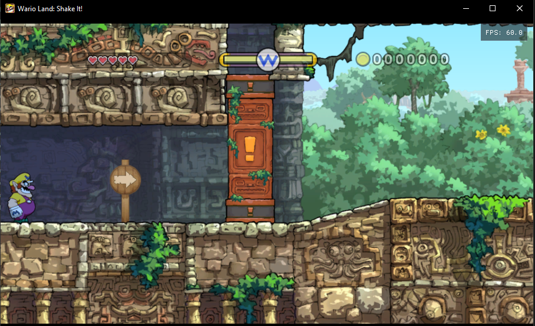
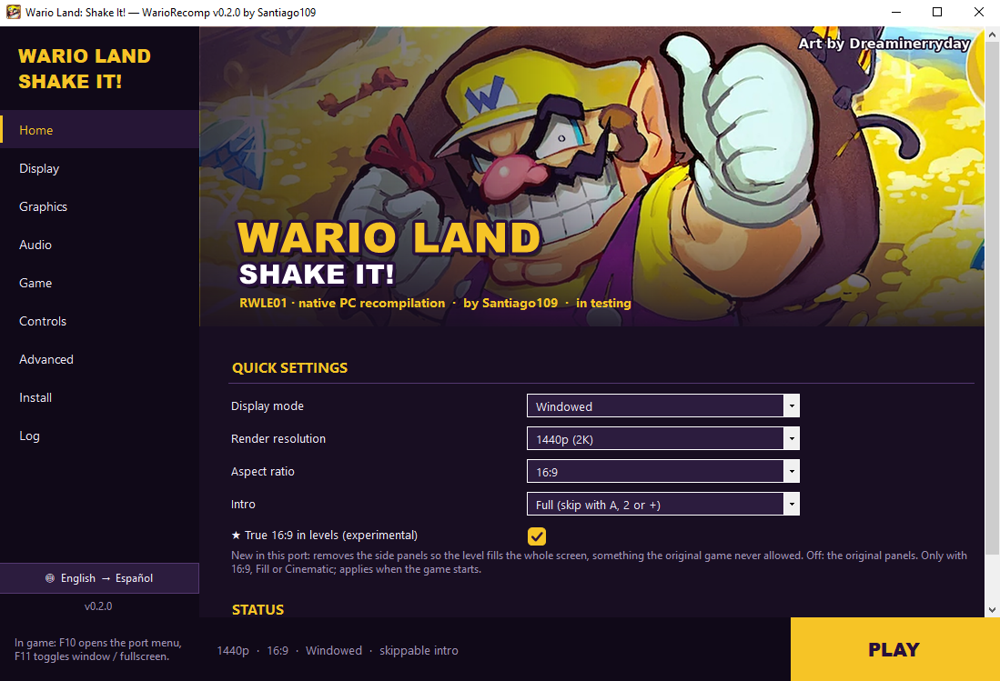

# WarioRecomp — Wario Land: Shake It! for PC

> ⚠️ **Testing build.** The game boots, saves and is playable, but parts of it are still untested: expect
> graphical glitches, crashes or features that don't respond yet. If you find one, please open an *issue* and
> attach the log (`Play\UserData\Logs\...\console.log`, or the launcher's **Log** page).

**WarioRecomp** is an unofficial native PC port of *Wario Land: Shake It!* (Wii, 2008, US release `RWLE01`),
by **Santiago109**. The game's PowerPC code is **statically recompiled** to C++ with
[WiiCompiled](https://github.com/patchzyy/Wiicompiled) and runs as a regular Windows program, **not in an
emulator**: the Wii system libraries (video, audio, controllers, disc, saves) are replaced with native code.

<p align="center">
  
  
  
</p>
<p align="center">
  
  
  <br><sub>Full 16:9 in levels (experimental): no side panels, the level fills the screen.</sub>
</p>
<p align="center">
  
</p>

## Features

- **Render resolution** from the original 480p up to 720p, 1080p and 1440p.
- **Aspect ratio:** true 16:9 widescreen (the game itself draws wider), fill the window, cinematic 2.39:1, or
  the original 4:3.
- **Full 16:9 in levels** *(experimental, Display page)*: removes the side panels the game frames its 4:3 play
  area with, and shows the level across the whole screen. The camera, the room edges and what the game draws all
  follow the wider view (the mission and treasure icons are still shown in the pause menu).
- **Windowed, borderless or exclusive fullscreen** (F11 switches in game), VSync and an FPS counter.
- **Direct3D 12 or Vulkan** (through Aurora / Dawn).
- **Experimental frame interpolation** to 120 FPS.
- **Gamepad and keyboard** with full remapping: Xbox, PlayStation (DualSense / DualShock 4) and Nintendo Pro
  Controller.
- **Wii Remote motion:**
  - **shake** with L2/R2 (continuous shaking while held, like on the Wii);
  - **tilt** with L1/R1 (30°) or with the **left stick**, which aims up to 85° in the direction you push;
  - **DualSense accelerometer**: on by default. Tilt the controller itself like a sideways Wii Remote;
    the left stick, L1/R1 (tilt) and L2/R2 (shake) work at the same time and take over while held. Click the
    touchpad to turn the sensors off.
- **Skippable intro** with one button .
- **Launcher** with display, graphics, audio, game and controls settings, disc import, save backups, the game
  log and one-click install.
- **Import the game from your own disc image:** `.iso`, `.wbfs`, `.ciso`, `.rvz`, `.wia` or `.gcz`.
- **Automatic save backups** before every start (the last 10 are kept).
- **Texture packs:** dump the game's textures and load high-resolution replacements.
- Game language (English, Spanish, French) and launcher language (English, Spanish).

## Game data

This repository and its downloads **contain nothing from the game**: no game executable, no game data and no
translated code. You need **your own copy** of *Wario Land: Shake It!* (US, `RWLE01`, unmodified). The
launcher reads it, checks that it is the right one (`main.dol` with SHA-256 `053BE60D…912A`) and **builds the
port on your PC**, the same way the WiiCompiled installer does.

## How to play

**Requirements**

- 64-bit Windows 10 or 11.
- A graphics card with Direct3D 12 or Vulkan.
- About 3 GB of free space for the build, plus 4.4 GB if the launcher extracts your disc image.
- 16 GB of RAM or more recommended while building.
- Your disc as `.iso`, `.wbfs`, `.ciso` or `.rvz` (or already extracted to a folder with `sys\` and `files\`).

The download (~250 MB) already includes the compiler and every build tool, so installing needs no internet.

**Steps**

1. Download the latest release (`WarioRecomp-<version>.zip`) and unzip it to a folder, e.g. `D:\WarioRecomp`.
2. Open `WarioLauncher.exe`. Windows may warn because it isn't signed: *More info → Run anyway*.
3. The launcher opens on **Install**: press **Install**, then pick your disc image and the folder to extract it to.
4. Wait while it extracts the game and builds the port on your PC (15 to 45 minutes depending on the PC); the
   progress is shown on the page.
5. Press **PLAY**.

## Controls

| Action (sideways Wii Remote) | Keyboard | DualSense / PlayStation |
|---|---|---|
| Move | Arrow keys | D-pad |
| Jump (2 button) | X / Space | ✕ |
| Run / attack (1 button) | Z / Left Shift | ○ / □ |
| A button | A | △ |
| Shake | C / Left Ctrl | L2 / R2 |
| Tilt left / right | Q / E | L1 / R1 |
| Tilt / aim with the stick | — | Left stick |
| + (pause) | Enter / Esc | Options |
| − | - / Tab | Create |
| Motion sensors off / on | — | Touchpad click |
| Skip the intro | Enter / Space / X | ✕ / ○ / Options |

Xbox and Nintendo controllers use the same button positions. In game, **F10** opens the port's menu and **F11**
toggles window / fullscreen. Everything can be remapped on the launcher's **Controls** page, where you can also
choose whether the left stick tilts/aims or moves, and invert the sensor axes.

## The launcher

| Page | What's there |
|---|---|
| Home | Quick settings, game status and the PLAY button |
| Display | Window mode, window size, aspect ratio, full 16:9 in levels, VSync, FPS counter |
| Graphics | Render resolution, frame interpolation, Direct3D 12 / Vulkan, GPU compatibility, textures |
| Audio | Master volume, mute, audio mixing thread |
| Game | Game folder, disc import, saves folder, game language, intro, save backups |
| Controls | Keyboard and gamepad mapping per action, motion and sensors, rumble |
| Advanced | Launcher language, desktop shortcut, folders, clear the shader cache, credits |
| Install | Import the disc and build / rebuild the port |
| Log | The latest game log, ready to paste into an *issue* |

Until the port is installed, only **Install** and **Log** are available. The language button at the bottom of
the left menu switches English / Spanish at any time. Settings are stored in `Play\UserData\Config.toml` (the
in-game F10 menu changes the same values). The header image and the icon live in `local-assets\`
(`launcher_banner.jpg`, `wario.ico`); both use fan art by **Dreaminerryday**. To use your own header,
put a `launcher_banner.jpg` or `.png` in `Play\UserData\`.

## Saves

Saves are in `Play\UserData\NAND\title\00010000\52574c45\data` (`WLS.bin` and `banner.bin`), or in the folder
you choose on the **Game** page. Before every start the launcher copies them to `Play\UserData\SaveBackups`, and
**Game → Restore** goes back to an earlier copy.

## Updating

The launcher checks for a new version when it starts (and on **Install → Check for updates**). It downloads
only the code from this repository, never any game data, and then rebuilds on your PC: a quick rebuild
(minutes) when the change only touches the runtime, or a full one (15 to 45 minutes) when the translation
changed. Your imported game, saves and settings are kept (they are all in `Play\UserData`).

You can also unzip a new release over the old folder and rebuild from **Install**.

For maintainers: bump `version` in `version.json`, and set `quick_from` to the oldest version that can
still use a quick rebuild (set it to the new version when the translation changes).

## Building from source

The launcher does all of this for you; by hand it is:

```
Build-WarioRecomp.cmd         downloads missing tools, translates the game, builds it and runs a 60 s test
Quick-Rebuild.cmd             rebuilds without translating or downloading again
Build-Launcher.cmd            builds the launcher (.NET Framework 4.8)
Make-Release.cmd              makes dist\WarioRecomp-<version>.zip (with nothing from the game)
```

The first time, point the build at your game: import it in the launcher, or run
`tools\build-wario.ps1 -GameData D:\path\to\DATA` (the folder with `sys\main.dol`).

| Folder | Contents |
|---|---|
| `fw/` | The parts of WiiCompiled the build uses: the C# translator and the dependency scripts |
| `projects/wario/` | Translation setup: `recomp.yml`, the function map and the verified Wario addresses |
| `runtime/` | The runtime adapted to Wario (adapted from WiiCompiled's runtime) |
| `aurora/` | Aurora, the Wii GX graphics layer (adapted from WiiCompiled's copy) |
| `tools/` | Build scripts (port, launcher, release package) |
| `launcher/` | The launcher (C# WinForms) |
| `local-assets/` | Launcher icon and header image (fan art by Dreaminerryday) |
| `screenshots/` | The images in this README |

## Status

Working: boot, intro (and skipping it), menus, saves (create, load, save), the world map, the levels tested so
far, audio, 16:9, gamepad and keyboard. Still to test or to do:

- Playing through the whole game (bosses, every level and the 12 story movies).
- The DualSense accelerometer, and shaking everywhere the game asks for it.
- Separate music, sound effects and voice volumes.
- An HD texture pack.

## Credits

- **Santiago109** — the port.
- **Dreaminerryday** — the Wario fan art used for the launcher header and the icon.
- **[WiiCompiled](https://github.com/patchzyy/Wiicompiled)** — patchzyy and contributors: recompiler and runtime (GPL-3.0).
- **Aurora** — Luke Street: Wii GX graphics on WebGPU (MIT). Dawn, SDL3 and the other components are listed in
  [`fw/THIRD-PARTY-NOTICES.md`](fw/THIRD-PARTY-NOTICES.md).
- **[nod / nodtool](https://github.com/encounter/nod)** — Luke Street: Wii disc image reading (MIT).
- **[Dolphin Emulator](https://dolphin-emu.org)** — Wii SDK function signature database (GPL-2.0+).
- **[llvm-mingw](https://github.com/mstorsjo/llvm-mingw)**, **CMake**, **Ninja** and **.NET** — building.

## License

GPL-3.0 (see [`LICENSE`](LICENSE)), like WiiCompiled. Third-party components keep their own licenses.

## Disclaimer

This is an **unofficial** fan project. It is not affiliated with, or endorsed by, Nintendo or Good-Feel. It
contains no game code or data: you need your own legal copy. *Wario Land: Shake It!* and Wario are trademarks of
Nintendo.
